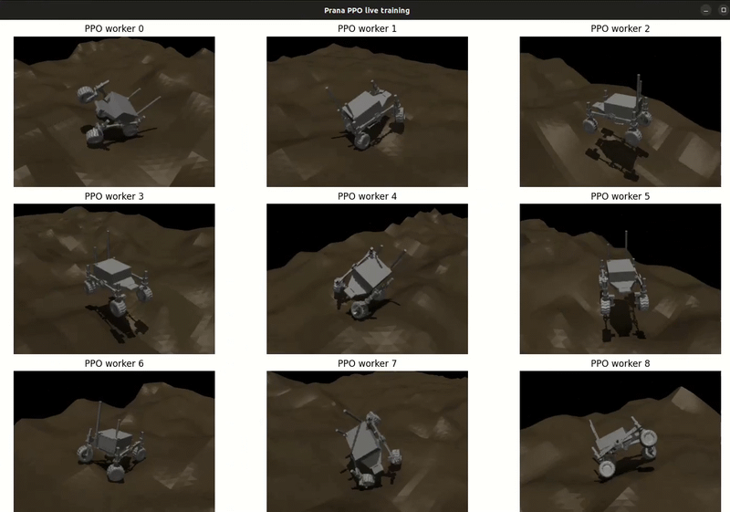

# Ezio Prana Rover Recovery



This project trains a MuJoCo rover recovery policy. The rover has four-wheel
independent steering and a rocker-differential suspension. Terrains and ditch
starts are generated procedurally, so the same experiment can be reproduced
from its seed.

## Packages

- `src/prana_description`: rover URDF/MuJoCo model and collision proxies.
- `src/prana_mujoco_drive`: manual MuJoCo teleoperation and 4WIS kinematics.
- `src/prana_recovery`: Gymnasium environment, terrain/scenario generation,
  PPO training, evaluation, and optional render viewers.

## Install

Install PyTorch for the training computer first, then:

```bash
python3 -m pip install -r src/prana_recovery/requirements-training.txt
```

## Train

```bash
python3 src/prana_recovery/scripts/train_prana_recovery.py \
  --num-envs 8 --timesteps 2500000 --device cuda \
  --output runs/prana_recovery_ditches_1 \
  --terrain-height-range 1.6
```

Training is headless by default. For a short visual inspection, add
`--render --show-precheck --render-envs 2`. The precheck display replays the
forward, sideways, and yaw tests used to verify that a sampled rover is really
stuck; it is not recommended for a long run because rendering is expensive.

Fine-tune a compatible saved policy with `--resume`; `--timesteps` is then the
number of **additional** training steps. Use a new output directory:

```bash
python3 src/prana_recovery/scripts/train_prana_recovery.py \
  --num-envs 8 --timesteps 1000000 --device cuda \
  --resume runs/prana_recovery_ditches_1/ppo_prana_recovery \
  --output runs/prana_recovery_ditches_1_continue \
  --terrain-height-range 1.0
```

Resuming requires the same action space and observation shape, including the
history length and numeric state fields. Terrain seeds, terrain relief, and
reward weights may change.

Important training parameters include:

- `--num-envs`, `--timesteps`, `--device`, `--output`
- `--terrain-height-range`
- `--history-frames` (past camera/state frames)
- `--precheck-steering-steps`, `--precheck-steps`,
  `--precheck-translation`
- `--mobility-window-steps`, `--mobility-displacement`, `--mobility-path`
- `--max-reset-terrain-attempts` (discarded terrain seeds before reset fails)

## Evaluate

Use the same terrain and recovery parameters used during training:

```bash
python3 src/prana_recovery/scripts/evaluate_prana_recovery.py \
  runs/prana_recovery_ditches_1/ppo_prana_recovery \
  --episodes 30 --seed 1000 --terrain-height-range 1.6
```

Add `--render --show-precheck` to inspect the accepted ditch start and its
precheck. Add `--mujoco-viewer --episodes 1` for MuJoCo's interactive free
camera instead; `--show-precheck` uses the Matplotlib renderer and cannot be
combined with the native viewer.

## How recovery works

The environment first places and passively settles the rover in a procedural
ditch. It then tests forward, sideways, and yaw motion. Starts that move beyond
the precheck threshold are discarded; accepted starts are restored to their
settled state before PPO begins.

The policy receives a short history of simulated front-facing ZED-like depth
maps plus rover state and previous motor commands. A Stable-Baselines3 PPO
`MultiInputPolicy` uses a CNN for the terrain maps and an MLP for numeric state,
then fuses their features to output eight direct commands: four wheel speeds
and four steering targets.

Reward increases with displacement away from the stuck start and favours
steady, upright, smooth motion. It penalizes energy, abrupt commands, body
contacts, and tipping. Success is reached after sustained planar XY movement
for the configured window; rotating in place does not count.

Old policies are not comparable after changing terrain, observation, or
precheck parameters. Train a new output directory when those settings change.
